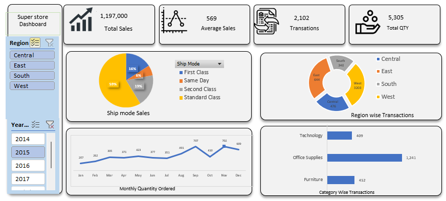

# Super Store Sales Data Dashboard 


## Project Overview
This project transforms a raw Super Store sales dataset into an interactive, dynamic Excel Dashboard. It was designed to provide stakeholders with immediate, actionable business intelligence regarding regional performance, seasonal order volume, and category-specific revenue. 

By leveraging advanced Excel Data Modeling, Pivot Tables, and dynamic slicers, this dashboard efficiently handles nearly 10,000 transaction records to deliver real-time metrics.

## 📸 Visuals & Previews

### 1. Final Sales Dashboard
Interactive frontend featuring dynamic slicers, KPIs, and demographic breakdowns.


### 2. Pivot Report Backend
The data aggregation engine powering the dashboard's interactive elements.
pivot report.png

## ⚙️ Core Features & Analytics
- **Dynamic KPI Tracking:** Real-time calculation of **Total Sales ($5.8M+)**, **Total Quantity (25K+)**, and **Average Sales**.
- **Interactive Slicers:** One-click filtering by **Region** (Central, East, South, West) and **Order Year**.
- **Ship Mode Distribution:** Donut charts breaking down preferred shipping methods (Standard Class, First Class, etc.).
- **Regional Transactions:** Visualizations tracking transaction density and profitability across specific geographic zones.
- **Monthly Volume Trends:** Time-series line charts tracking the quantity ordered month-over-month to identify seasonal peaks.
- **Category Profitability:** Bar chart comparisons across Technology, Office Supplies, and Furniture.

## 📂 Repository Structure
```text
📦 superstore-sales-dashboard
 ┣ 📜 Final sales Dashboard.png     # Screenshot of the final Excel Dashboard
 ┣ 📜 image_598559.png              # Screenshot of the backend Pivot Report
 ┣ 📜 EXCEL DASHBOARD.xlsx          
 ┗ 📜 README.md                     # Project documentation
